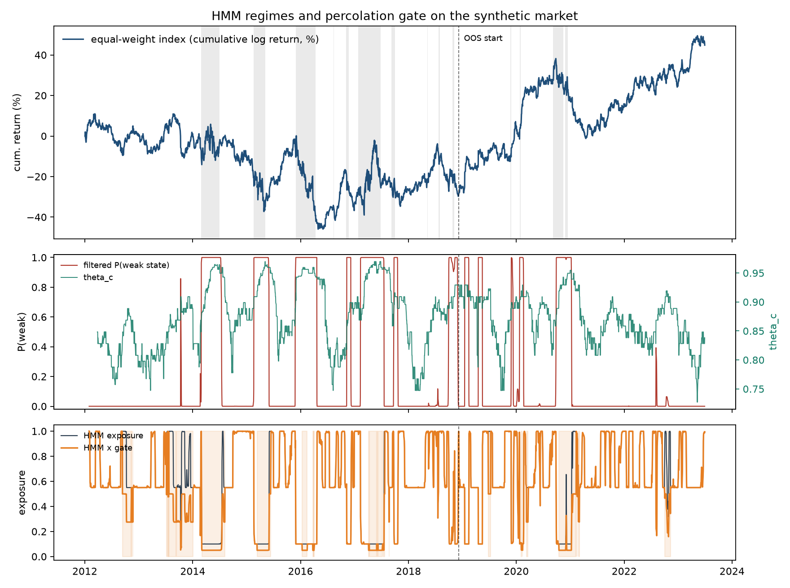

# hmm-percolation

[](https://github.com/cxy2696/hmm-percolation/actions/workflows/ci.yml)

用 C11 写的隐马尔可夫模型与渗流工具。核心库不依赖金融数据，也不依赖第三方库；`apps/hp_regime` 是一个用合成市场数据跑通的 regime 分析与回测示例。Python 和 Julia 通过共享库调用同一套 C 代码。

我最初写它是为了回答两个具体问题：

1. 给定一段带噪声的收益序列，能不能把“状态”估出来，并且让状态编号在不同窗口里保持可比？
2. 给定一组资产的相关矩阵，横截面什么时候会从“连成一片”突然碎掉？这个结构变化能不能用来控制回撤？

这两个问题分别对应 HMM 和渗流。仓库把两者拆成独立的库，再用一个应用层把它们拼起来。**这不是一个交易系统**，也没有真实市场数据；`data/` 里的价格是生成的，目的是让每个数字都能复现。

## 现在有什么

- `libhp`：离散 HMM、对角 GMM-HMM、前向/后向、Viterbi、Baum-Welch、BIC 选阶、模型持久化。
- 渗流：二维键/点渗流、并查集、ER/配置模型、相关矩阵阈值图、有限尺寸标定。
- 应用层：特征、走步重估、仓位映射、渗流闸门、回测。
- 4 个命令行工具：`hp_synth`、`hp_regime`、`hp_connectedness`、`hp_perc_lab`。
- Python（ctypes）与 Julia（ccall）绑定。
- 数学笔记：[docs/mathematics.md](docs/mathematics.md)。里面明确区分了“证明了的”“引用文献的”和“只是数值观察的”。

## 构建

需要 C11 编译器、C++17 编译器、GNU Make；CMake 可选。

```bash
make -j
make check          # 30 个 C 测试 + 5 个 C++ 测试
make shared         # 共享库，Python/Julia 绑定需要
```

CMake：

```bash
cmake -S . -B build/cmake -DCMAKE_BUILD_TYPE=Release
cmake --build build/cmake -j
ctest --test-dir build/cmake --output-on-failure
```

没有 BLAS、Eigen、numpy 或网络依赖。

## 跑一遍

```bash
./build/hp_synth --days 3000 --assets 10 --regimes 3 --seed 20240101 \
  --out data/synthetic_panel.csv --truth data/synthetic_truth.csv

./build/hp_regime --csv data/synthetic_panel.csv --states 3 \
  --train-frac 0.6 --refit 250 --seed 42 --outdir out/regime

./build/hp_connectedness --csv data/synthetic_panel.csv --window 60 \
  --outdir out/connectedness

./build/hp_perc_lab --mode scaling --kind bond --sizes 32,64,128,256 \
  --reps 200 --iters 16 --out out/perc_scaling_bond.csv \
  --json out/perc_scaling_bond.json
```

`hp_regime` 会写 `states.csv`、`equity.csv`、`metrics.json`、`report.md` 和模型文件。完整流程用 `./scripts/reproduce.sh`，约 30 秒。

样本外 1191 个交易日，5 bps/单位换手：

| 状态数 | 策略 | 总收益 | Sharpe | 最大回撤 |
| --- | --- | --- | --- | --- |
| 3 | 买入持有 | 92.77% | 0.85 | -33.83% |
| 3 | HMM | 53.40% | 0.77 | -22.40% |
| 3 | HMM × 渗流闸门 | 60.65% | 0.88 | -16.90% |
| 2 | HMM / +闸门 | 68.89% / 72.06% | 0.83 / 0.87 | -15.70% / -13.34% |
| 5（BIC） | HMM / +闸门 | 68.94% / 72.69% | 0.95 / 1.03 | -18.52% / -14.36% |

这些数字只对应一份固定种子的合成数据和一个特定成本假设。它们说明管线能跑、仓位没有偷看未来，不说明策略在真实市场有效。



## 仓库结构

```
include/hp/        C 头文件
src/               C 实现
src/app/           C++17 应用层
apps/              CLI
bindings/python/   ctypes 绑定
bindings/julia/    ccall 绑定
examples/          不带金融假设的最小示例
tests/             C/C++ 测试
docs/              数学笔记、设计、用法、复现、结果
data/              合成数据
out/               固定种子生成的参考产物
```

核心库是通用的：HMM 的输入是整数符号序列或实数矩阵，渗流的输入是格点、度分布或图。金融部分在 `market/` 和 `app/`，删掉也不影响 `hmm/`、`perc/`、`core/`。

## 几个实现决定

- **只保留 log 域实现**。没有另写一套 scaled 前向算法；两套实现最容易在零概率和长序列上分叉。
- **GMM 用对角协方差**。特征只有两维，对角形式天然正定，省掉 Cholesky 修复。代价是刻画不了收益与波动的联合尾部。
- **状态按均值排序**。标签置换不影响似然；排序是为了让报告里的“弱势/震荡/强势”在不同窗口里能对齐。它不解决可辨识性。
- **多起点 + 分位数初始化**。EM 只保证局部；分位数初始化给一个不坏的起点，随机重启补漏。
- **加下限，但不假装精确 EM**。代码对概率和方差加了下限，并在数值回退时保留历史最优。这会让严格单调性证明不再逐字成立；测试里只做经验检查。
- **相关图用 `theta_half`**。`theta_peak`（susceptibility 最大点）在小样本上经常落在平台或边界；`theta_half` 是巨分量跌破 0.5 的插值点，语义更清楚。
- **回测起点**。第一个样本外决策在 `train_end` 收盘做出，收益从 `train_end+1` 开始。早先版本从 `train_end-1` 开始，白送了一天样本内信号；这个问题已经改掉，`tests/test_app.cpp` 里有对照。

## 数学

[docs/mathematics.md](docs/mathematics.md) 包含：

- HMM 联合分布因子化、前向/后向、平滑、Viterbi、Baum-Welch 的 E/M 步与单调性证明；
- 标签置换与一个发射退化的反例；
- 渗流的耦合单调性、一维 $p_c=1$、Galton-Watson 均值判据、带传播率的 $R_0$；
- 相关阈值图的单调性、因果滤波与回测时序；
- 明确列出没有证明的结论：二维 $p_c=1/2$、ER/配置模型渐近定理、一般 HMM 可辨识性、EM 全局收敛、有限尺寸标度。

如果只想看“代码里这些公式为什么对”，先读这篇；如果想知道“为什么这样设计”，读 [docs/design.md](docs/design.md)。

## Python / Julia

```bash
make shared

PYTHONPATH=bindings/python python3 -m unittest discover -s bindings/python/tests -v
PYTHONPATH=bindings/python python3 bindings/python/examples/regime_demo.py

julia --startup-file=no bindings/julia/test/runtests.jl
julia --startup-file=no bindings/julia/examples/regime_demo.jl
```

绑定只做 ABI 镜像和数组转换，不复制算法。Python 通过 `HPMARKET_LIB`、Julia 通过 `HP_LIB` 指定共享库路径。若 juliaup 启动器无法写配置，给它一个可写 HOME，例如 `HOME=/tmp/hp-julia-home julia ...`。

## 维护

- 版本：0.1.2，API 还可能变。模型文件格式有版本行；升级时不要静默改字段顺序。
- 数据：`data/` 全部由 `hp_synth` 生成，`data/README.md` 记录了种子和字段。
- 产物：`out/` 是参考结果，不是必须提交的运行缓存；重新生成用 `scripts/reproduce.sh`。
- 新结论：要么给证明，要么给文献引用，要么在文档里标成经验观察。三者不要混。
- 改动算法后至少跑 `make check`、Python 测试和 `scripts/reproduce.sh`；改动数值路径时再跑一次 ASan。

## 已知问题

- 合成市场是单因子的，相关性结构比真实市场干净；不要把这里的 Sharpe 当成预期收益。
- `hp_perc_config_giant` 是树近似。 $T=1$ 且存在二度链时，环会让它高估巨分量，代码只能作为平均场诊断。
- BIC 选 5 个状态在这份样本上样本外 Sharpe 反而最高；“状态多=过拟合”不是定理，反之也不是。
- 没有做 full-covariance GMM、网络化 HMM、FK/Potts、真实数据的复权/停牌/容量处理。
- 回测只计 5 bps 换手，没有冲击成本、借券费、涨跌停和容量约束。

## License

MIT，见 [LICENSE](LICENSE)。
